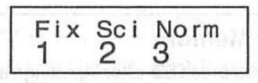

Sagitta-miniräknaren kan som standard visa tal i grundpotensform (vetenskaplig notation):

-   små tal som $0.000032$ visas som $3.2 ^{-05}$ eller $3.2e\text{-}05$

-   stora tal som $12000000$ visas som $1.2^{07}$ eller $1.2e\text{+}07$

Om du hellre vill se talen utskrivna i sin helhet gör du så här:

::: {.callout-note appearance="minimal"}
-   Tryck flera gånger på knappen **Mode** uppe till höger tills du ser skärmen nedan.

    {fig-align="center" width="138"}

-   Tryck **3** för att välja läget *Norm*.

-   Tryck **2** för att välja *Norm 2*. I det här läget används grundpotensform bara för mycket små och mycket stora tal.
:::
