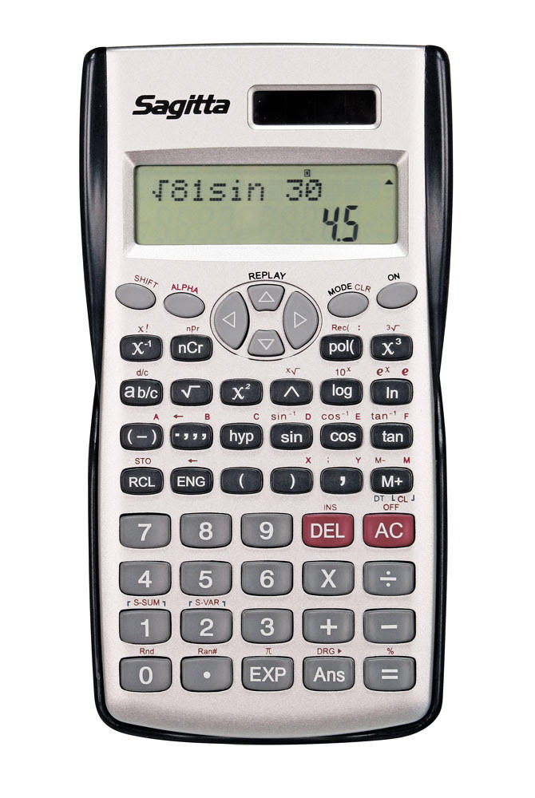

---
# Builds svminiraknare-guide.pdf, linked from sv/calculator.qmd.
# Not part of the website render (leading underscore); rebuild with
#   quarto render sv_guide-pdf.qmd
title: "Miniräknare vid tentamen på SU"
lang: sv
format:
  typst:
    output-file: miniraknare-guide.pdf
    include-before-body: ../../misc/pdf-style.typ
    papersize: a4
    margin:
      x: 2.2cm
      y: 2cm
---

> **De enda tillåtna miniräknarna är de som finns i tentasalarna**. Moderna miniräknare kan ha internetuppkoppling och AI-funktioner, så egna miniräknare är inte längre tillåtna.

I tentasalarna finns miniräknaren *Sagitta scientific calculator*.

{width="18%"}

## Så ändrar du decimalnotationen



## Så beräknar du potenser av talet e


